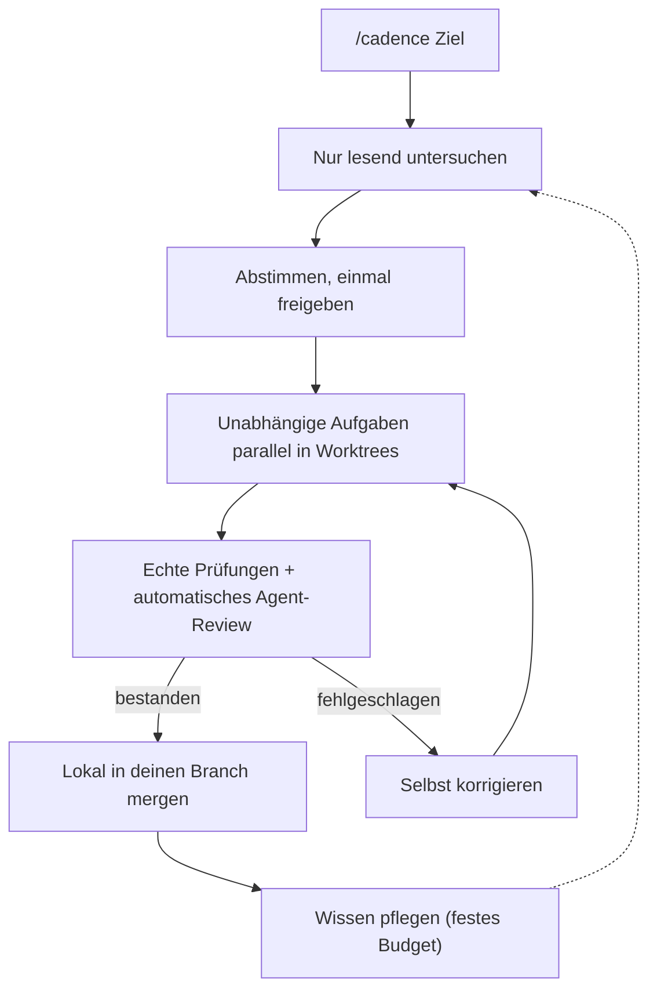
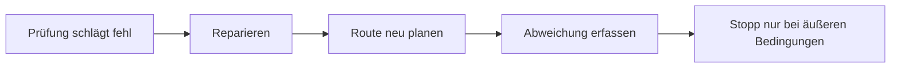
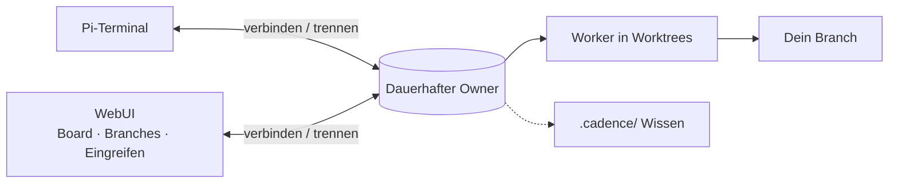

# Cadence

[English](README.md) · [简体中文](README.zh-CN.md) · [日本語](README.ja.md) · [한국어](README.ko.md) · [Deutsch](README.de.md) · [Français](README.fr.md) · [Español](README.es.md) · [Português (Brasil)](README.pt-BR.md) · [Русский](README.ru.md)

Cadence macht [Pi](https://www.npmjs.com/package/@earendil-works/pi-coding-agent) zu einem gesprächsgesteuerten Engineering-Workflow: `/cadence [Ziel]` eingeben, das Ergebnis einmal abstimmen, und ein dauerhafter Owner setzt um, repariert und prüft.
Im Terminal oder in der optionalen WebUI.

## So funktioniert es







## Warum Cadence

|                                         |                                                                                                                        |
| --------------------------------------- | ---------------------------------------------------------------------------------------------------------------------- |
| **Arbeit überlebt das Fenster**         | Clients verbinden und trennen sich nur; der Owner läuft weiter.                                                        |
| **Vor der Freigabe ändert sich nichts** | Erst lesende Untersuchung, dann eine lesbare Vereinbarung, die du bestätigst.                                          |
| **Verlässliche Ergebnisse**             | Echte Prüfungen und unabhängiges Review; Modelltext zählt nie als bestanden.                                           |
| **Schließt selbst ab**                  | Nach der Freigabe repariert, plant neu oder erfasst Abweichungen; Stopp nur bei Bedingungen außerhalb des Repositorys. |
| **Schneller durch Aufbau**              | Unabhängige Aufgaben laufen nebeneinander in eigenen Worktrees.                                                        |
| **Wissen wächst mit**                   | Routentabelle und festes Budget: Worker lesen nur Passendes, neue Erkenntnisse ersetzen veraltete.                     |
| **WebUI zum Sehen und Steuern**         | Aufgaben-Board, Revisionen, Abweichungen, Branches, Denken; mitten in der Antwort eingreifen oder einreihen.           |
| **Ein Verlauf**                         | Browser-Gespräche sind die Pi-Sitzungen des Projekts; an beiden Orten fortsetzbar.                                     |

> Cadence ist ein vertrauenswürdiger Assistent, **keine Sandbox**: Die Agenten nutzen Host-Werkzeuge im freigegebenen Checkout oder Worktree.
> Nur für Code verwenden, den du prüfen und wiederherstellen kannst.

## Installation

Benötigt Node `>=22.19.0` und Pi mit Login bei einem Modellanbieter; Cadence nutzt den Pi-Login.

```sh
npm install -g @abelxiaoxing/cadence
pi install "$(npm root -g)/@abelxiaoxing/cadence"
cadence server install   # optionale WebUI und Boot-Dienst
```

`cadence server install` gibt einen privaten Link aus (`http://127.0.0.1:17423/?token=…`).
Das Token gewährt Zugriff auf deinen Arbeitsbereich: Link nicht weitergeben.

## Verwendung

### Browser

1. Den ausgegebenen Link einmal öffnen (`cadence token-link --reveal` zeigt ihn erneut).
2. Mit der Schaltfläche unten rechts einen Arbeitsordner wählen.
3. `/cadence [Ziel]` senden und die Rückfragen beantworten.
4. **Implement this plan** klicken; Board und **Subagents**-Dock zeigen den Fortschritt.
   Bilder per Einfügen oder Ziehen ([Details](docs/conversation-mode.md#images-in-the-webui)).

### Terminal

`/cadence <Ziel>` einmal im Pi-Gespräch eines vertrauten Projekts eingeben; der Modus bleibt nach Abschluss aktiv.
`exit cadence` oder `退出 Cadence` beendet ihn, ohne angenommene Arbeit abzubrechen.
`/cadence-history [run-id]` ist nur lesend.
`CADENCE_PARALLEL` (Standard 4) legt die gleichzeitigen Worker fest.
Details: [Konversationsmodus](docs/conversation-mode.md), [Verlauf](docs/history.md).

```sh
cadence project open /absolute/project   # ein Owner, Port und Verlauf pro Projekt
```

## Dienst verwalten

```sh
cadence server status
cadence server restart     # nach Upgrade oder Änderung an .env / models.json
cadence server upgrade     # laden, installieren, neu starten; Rückfall, falls die neue Version nicht startet
cadence server stop
cadence server uninstall   # vor npm uninstall -g
cadence doctor             # Reste und jüngste Wiederherstellungen; --fix für den Rest
```

Nach Absturz oder Stromausfall ist keine Bereinigung nötig: Der nächste Start stellt wieder her und sagt, was er getan hat.
Siehe [Dienstverwaltung](docs/service-management.md) und [Fernzugriff](docs/remote-access.md).

## Entwicklung

Pi kann auch einen lokalen Checkout oder ein gepacktes Tarball laden: absoluten oder relativen Pfad zu `packages` in Pi hinzufügen oder `pi -e ./cadence` probieren.
Cadence benötigt Pi 1.5.0 oder einen kompatiblen 1.x-Host; Entwicklungs-Pins und getestete Laufzeiten sind keine allgemeinen Kompatibilitätszusagen.

```sh
bun install
bun run verify
```

Hinweise nach Bereich: [engineering/](engineering/) und [AGENTS.md](AGENTS.md). `verify` ist das einzige schnelle Gate; es braucht einen offiziellen Node-Build und ein privates temporäres Verzeichnis ([Verifikation](engineering/verification.md)).

## Lizenz

MIT.
Gebündelte Anpassungen, Schriften und Fremdkomponenten behalten ihre Lizenzen: [Wiederverwendung und Verteilung](docs/reuse-and-distribution.md), [Drittanbieterhinweise](THIRD_PARTY_NOTICES.md).
