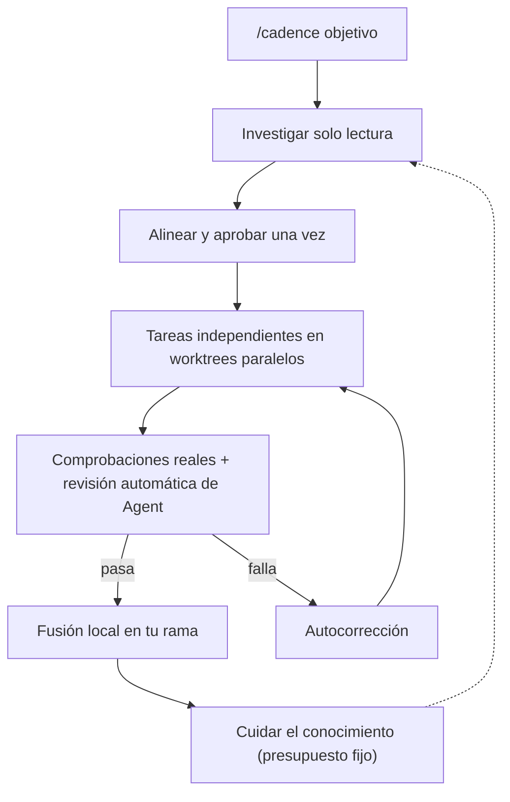
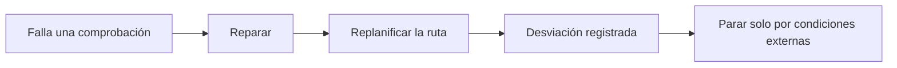
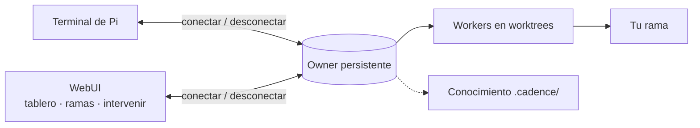

# Cadence

[English](README.md) · [简体中文](README.zh-CN.md) · [日本語](README.ja.md) · [한국어](README.ko.md) · [Deutsch](README.de.md) · [Français](README.fr.md) · [Español](README.es.md) · [Português (Brasil)](README.pt-BR.md) · [Русский](README.ru.md)

Cadence convierte [Pi](https://www.npmjs.com/package/@earendil-works/pi-coding-agent) en un flujo de ingeniería guiado por conversación: escribe `/cadence [objetivo]`, acuerda el resultado una vez y un owner persistente implementa, se recupera y verifica.
Desde el terminal o la WebUI opcional.

## Cómo funciona







## Por qué Cadence

|                                       |                                                                                                                           |
| ------------------------------------- | ------------------------------------------------------------------------------------------------------------------------- |
| **El trabajo sobrevive a la ventana** | Los clientes solo se conectan y desconectan; el owner sigue.                                                              |
| **Nada cambia antes de aprobar**      | Investigación de solo lectura y un acuerdo legible que confirmas.                                                         |
| **Resultados fiables**                | Comprobaciones reales y revisión independiente; el texto del modelo nunca cuenta como aprobado.                           |
| **Termina solo**                      | Tras aprobar, repara, replanifica o registra una desviación, y solo para por condiciones fuera del repositorio.           |
| **Más rápido por diseño**             | Las tareas independientes corren en paralelo en sus propios worktrees.                                                    |
| **El conocimiento se acumula**        | Tabla de rutas y presupuesto fijo: los workers leen lo que corresponde y las lecciones nuevas sustituyen a las obsoletas. |
| **WebUI que muestra y dirige**        | Tablero de tareas, revisiones, desviaciones, ramas, razonamiento; intervenir o encolar un mensaje en plena respuesta.     |
| **Un solo historial**                 | Las conversaciones del navegador son las sesiones de Pi del proyecto; continúa en cualquiera.                             |

> Cadence es un asistente de confianza, **no un sandbox**: sus agentes usan herramientas del host en el checkout o worktree aprobado.
> Úsalo con código que puedas revisar y recuperar.

## Instalación

Requiere Node `>=22.19.0` y Pi con sesión iniciada en un proveedor de modelos; Cadence reutiliza el inicio de sesión de Pi.

```sh
npm install -g @abelxiaoxing/cadence
pi install "$(npm root -g)/@abelxiaoxing/cadence"
cadence server install   # WebUI y servicio de arranque opcionales
```

`cadence server install` muestra un enlace privado (`http://127.0.0.1:17423/?token=…`).
El token da acceso a tu espacio de trabajo: mantén el enlace privado.

## Uso

### Navegador

1. Abre una vez el enlace mostrado (`cadence token-link --reveal` lo vuelve a mostrar).
2. Elige una carpeta de trabajo con el botón inferior derecho.
3. Envía `/cadence [objetivo]` y responde a las preguntas.
4. Pulsa **Implement this plan** y sigue el tablero y el dock **Subagents**.
   Imágenes pegadas o arrastradas ([detalles](docs/conversation-mode.md#images-in-the-webui)).

### Terminal

Escribe `/cadence <objetivo>` una vez en la conversación de Pi de un proyecto de confianza; el modo sigue activo al terminar.
`exit cadence` o `退出 Cadence` lo cierra sin cancelar el trabajo aceptado.
`/cadence-history [run-id]` es de solo lectura.
`CADENCE_PARALLEL` (4 por defecto) fija los workers simultáneos.
Detalles: [modo conversación](docs/conversation-mode.md), [historial](docs/history.md).

```sh
cadence project open /absolute/project   # un owner, puerto e historial por proyecto
```

## Gestionar el servicio

```sh
cadence server status
cadence server restart     # tras actualizar o cambiar .env / models.json
cadence server upgrade     # descargar, instalar, reiniciar; vuelve atrás si la nueva versión falla
cadence server stop
cadence server uninstall   # antes de npm uninstall -g
cadence doctor             # restos y recuperaciones recientes; --fix para el resto
```

Un fallo o apagón no exige limpieza: el siguiente arranque se recupera y dice qué hizo.
Consulta [gestión del servicio](docs/service-management.md) y [acceso remoto](docs/remote-access.md).

## Desarrollo

Pi también puede cargar un checkout local o un tarball empaquetado: añade su ruta absoluta o relativa a `packages` de Pi, o prueba `pi -e ./cadence`.
Cadence requiere Pi 1.5.0 o un host 1.x compatible; los pines de desarrollo y los runtimes probados no son promesas de compatibilidad universal.

```sh
bun install
bun run verify
```

Guías por área en [engineering/](engineering/) y [AGENTS.md](AGENTS.md). `verify` es la única puerta rápida; requiere un build oficial de Node y un directorio temporal privado ([verificación](engineering/verification.md)).

## Licencia

MIT.
Las adaptaciones, fuentes y componentes de terceros incluidos conservan sus licencias: [reutilización y distribución](docs/reuse-and-distribution.md), [avisos de terceros](THIRD_PARTY_NOTICES.md).
