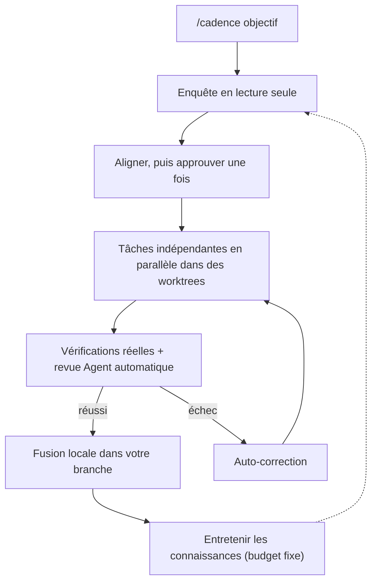
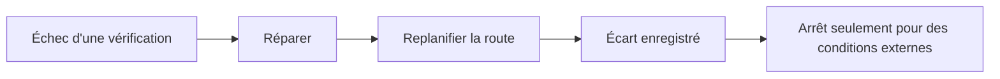
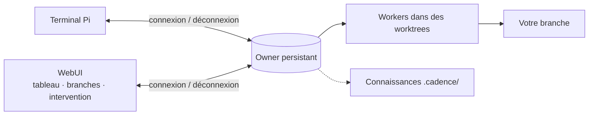

# Cadence

[English](README.md) · [简体中文](README.zh-CN.md) · [日本語](README.ja.md) · [한국어](README.ko.md) · [Deutsch](README.de.md) · [Français](README.fr.md) · [Español](README.es.md) · [Português (Brasil)](README.pt-BR.md) · [Русский](README.ru.md)

Cadence transforme [Pi](https://www.npmjs.com/package/@earendil-works/pi-coding-agent) en workflow d'ingénierie piloté par la conversation : saisissez `/cadence [objectif]`, validez le résultat une fois, et un owner persistant implémente, reprend et vérifie.
Dans le terminal ou via la WebUI optionnelle.

## Fonctionnement







## Pourquoi Cadence

|                                        |                                                                                                                      |
| -------------------------------------- | -------------------------------------------------------------------------------------------------------------------- |
| **Le travail survit à la fenêtre**     | Les clients se connectent et se déconnectent seulement ; l'owner continue.                                           |
| **Rien ne change avant l'approbation** | Enquête en lecture seule, puis un accord lisible que vous confirmez.                                                 |
| **Résultats fiables**                  | Vérifications réelles et revue indépendante ; un texte du modèle ne vaut jamais réussite.                            |
| **Termine seul**                       | Après approbation, il répare, replanifie ou enregistre un écart, et ne s'arrête que pour des conditions hors dépôt.  |
| **Plus rapide par conception**         | Les tâches indépendantes s'exécutent côte à côte dans leurs worktrees.                                               |
| **Les connaissances s'accumulent**     | Table de routes et budget fixe : les workers lisent ce qui correspond, les nouvelles leçons remplacent les périmées. |
| **Une WebUI qui montre et pilote**     | Tableau des tâches, révisions, écarts, branches, réflexion ; intervenir ou mettre en file en pleine réponse.         |
| **Un seul historique**                 | Les conversations du navigateur sont les sessions Pi du projet ; reprise des deux côtés.                             |

> Cadence est un assistant de confiance, **pas un bac à sable** : ses agents utilisent les outils de l'hôte dans le checkout ou worktree approuvé.
> À utiliser sur du code que vous pouvez relire et restaurer.

## Installation

Nécessite Node `>=22.19.0` et Pi connecté à un fournisseur de modèles ; Cadence réutilise la connexion de Pi.

```sh
npm install -g @abelxiaoxing/cadence
pi install "$(npm root -g)/@abelxiaoxing/cadence"
cadence server install   # WebUI et service de démarrage optionnels
```

`cadence server install` affiche un lien privé (`http://127.0.0.1:17423/?token=…`).
Le jeton donne accès à votre espace de travail : gardez le lien privé.

## Utilisation

### Navigateur

1. Ouvrez une fois le lien affiché (`cadence token-link --reveal` le réaffiche).
2. Choisissez un dossier de travail avec le bouton en bas à droite.
3. Envoyez `/cadence [objectif]`, puis répondez aux questions.
4. Cliquez sur **Implement this plan** et suivez le tableau et le dock **Subagents**.
   Images par collage ou glisser-déposer ([détails](docs/conversation-mode.md#images-in-the-webui)).

### Terminal

Saisissez `/cadence <objectif>` une fois dans la conversation Pi d'un projet de confiance ; le mode reste actif après l'objectif.
`exit cadence` ou `退出 Cadence` le quitte sans annuler le travail accepté.
`/cadence-history [run-id]` est en lecture seule.
`CADENCE_PARALLEL` (4 par défaut) fixe le nombre de workers simultanés.
Détails : [mode conversation](docs/conversation-mode.md), [historique](docs/history.md).

```sh
cadence project open /absolute/project   # un owner, un port et un historique par projet
```

## Gérer le service

```sh
cadence server status
cadence server restart     # après une mise à jour ou un changement de .env / models.json
cadence server upgrade     # télécharger, installer, redémarrer ; retour arrière si la nouvelle version échoue
cadence server stop
cadence server uninstall   # avant npm uninstall -g
cadence doctor             # restes et reprises récentes ; --fix pour le reste
```

Un plantage ou une coupure n'exige aucun nettoyage : le démarrage suivant reprend et indique ce qu'il a fait.
Voir [gestion du service](docs/service-management.md) et [accès distant](docs/remote-access.md).

## Développement

Pi peut aussi charger un checkout local ou un tarball empaqueté : ajoutez son chemin absolu ou relatif aux `packages` de Pi, ou essayez `pi -e ./cadence`.
Cadence nécessite Pi 1.5.0 ou un hôte 1.x compatible ; les versions épinglées et runtimes testés ne sont pas des promesses de compatibilité universelle.

```sh
bun install
bun run verify
```

Guides par domaine : [engineering/](engineering/) et [AGENTS.md](AGENTS.md). `verify` est l'unique barrière rapide ; il faut un build Node officiel et un répertoire temporaire privé ([vérification](engineering/verification.md)).

## Licence

MIT.
Adaptations, polices et composants tiers inclus conservent leurs licences : [réutilisation et distribution](docs/reuse-and-distribution.md), [mentions tierces](THIRD_PARTY_NOTICES.md).
