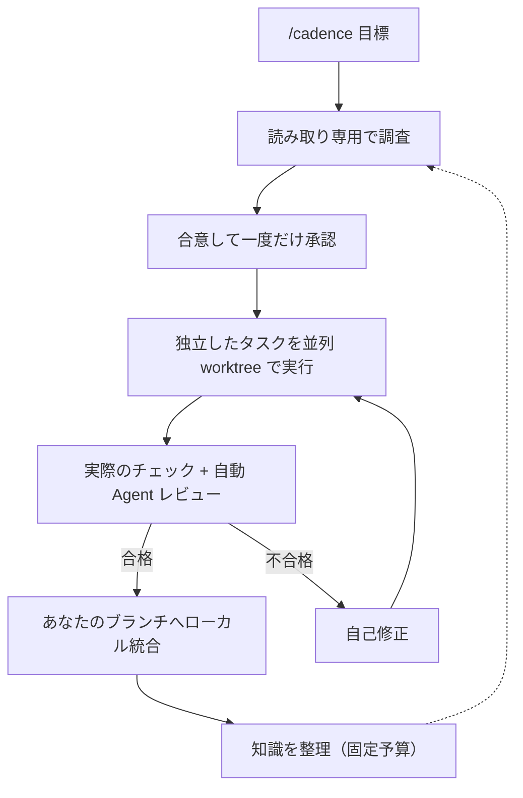
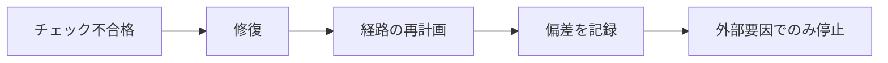
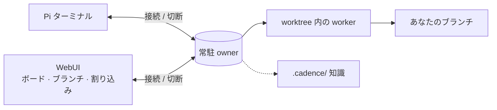

# Cadence

[English](README.md) · [简体中文](README.zh-CN.md) · [日本語](README.ja.md) · [한국어](README.ko.md) · [Deutsch](README.de.md) · [Français](README.fr.md) · [Español](README.es.md) · [Português (Brasil)](README.pt-BR.md) · [Русский](README.ru.md)

Cadence は [Pi](https://www.npmjs.com/package/@earendil-works/pi-coding-agent) を会話駆動のエンジニアリングワークフローにします。
`/cadence [目標]` を入力し、成果を一度合意すれば、常駐 owner が実装・復旧・検証を進めます。
ターミナルでも、任意の WebUI でも使えます。

## 仕組み







## Cadence を使う理由

|                                    |                                                                                             |
| ---------------------------------- | ------------------------------------------------------------------------------------------- |
| **ウィンドウを閉じても作業は続く** | クライアントは接続と切断だけ。owner は動き続けます。                                        |
| **承認前は何も変更しない**         | 読み取り専用の調査の後、読める合意を一つ確認します。                                        |
| **信頼できる結果**                 | 実際のチェックと独立レビュー。モデルの文面は合格になりません。                              |
| **自力で完了**                     | 承認後は修復・再計画・偏差の記録を自動で行い、リポジトリ外の要因でのみ停止します。          |
| **設計から高速**                   | 独立したタスクは各 worktree で並列に動きます。                                              |
| **知識が積み上がる**               | ルーティング表と固定予算。worker は該当部分だけを読み、新しい知見が古いものを置き換えます。 |
| **見えて操作できる WebUI**         | タスクボード、経路の改訂、偏差、ブランチ、思考。返信中に割り込みや後送りも可能。            |
| **一つの履歴**                     | ブラウザの会話はプロジェクトの Pi セッション。どちらでも続けられます。                      |

> Cadence は信頼されたアシスタントであり、**サンドボックスではありません**。
> エージェントは承認された checkout / worktree でホストのツールを使います。
> 確認と復旧ができるコードで使ってください。

## インストール

Node `>=22.19.0` と、モデルプロバイダーにログイン済みの Pi が必要です。
Cadence は Pi のログインを再利用します。

```sh
npm install -g @abelxiaoxing/cadence
pi install "$(npm root -g)/@abelxiaoxing/cadence"
cadence server install   # 任意の WebUI と起動時サービス
```

`cadence server install` はプライベートリンク（`http://127.0.0.1:17423/?token=…`）を表示します。
トークンはワークスペースへのアクセスを許すため、リンクは公開しないでください。

## 使い方

### ブラウザ

1. 表示されたリンクを一度開きます（`cadence token-link --reveal` で再表示）。
2. 右下のボタンで作業フォルダを選びます。
3. `/cadence [目標]` を送り、確認の質問に答えます。
4. **Implement this plan** を押し、ボードと **Subagents** ドックで進捗を追います。
   画像は貼り付けやドロップで追加できます（[詳細](docs/conversation-mode.md#images-in-the-webui)）。

### ターミナル

信頼するプロジェクトの Pi 会話で `/cadence <目標>` を一度入力します。
目標が完了してもモードは維持されます。
`exit cadence` または `退出 Cadence` で終了しますが、承認済みの作業は取り消されません。
`/cadence-history [run-id]` は読み取り専用です。
`CADENCE_PARALLEL`（既定 4）で同時 worker 数を設定します。
詳細：[会話モード](docs/conversation-mode.md)、[履歴](docs/history.md)。

```sh
cadence project open /absolute/project   # プロジェクトごとに独立した owner・ポート・履歴
```

## サービス管理

```sh
cadence server status
cadence server restart     # アップグレードや .env / models.json の変更後
cadence server upgrade     # 取得・インストール・再起動。新版が起動しなければ戻す
cadence server stop
cadence server uninstall   # npm uninstall -g の前に
cadence doctor             # 残骸と最近の復旧。--fix で残りを処理
```

クラッシュや停電の後始末は不要です。
次回起動時に自動復旧し、何をしたか表示します。
[サービス管理](docs/service-management.md)、[リモートアクセス](docs/remote-access.md)を参照。

## 開発

Pi はローカル checkout やパック済み tarball も読み込めます。
絶対パスまたは相対パスを Pi の `packages` に追加するか、`pi -e ./cadence` を試してください。
Cadence は Pi 1.5.0 または互換の 1.x ホストを必要とします。
開発用のピンとテスト済みランタイムは、普遍的な互換性の約束ではありません。

```sh
bun install
bun run verify
```

領域別のガイドは [engineering/](engineering/) と [AGENTS.md](AGENTS.md)。
`verify` が唯一の高速ゲートで、公式 Node ビルドと専用の一時ディレクトリが必要です（[検証](engineering/verification.md)）。

## ライセンス

MIT。
同梱の改変、フォント、ベンダー部品は各ライセンスを保持します：[再利用と配布](docs/reuse-and-distribution.md)、[サードパーティ通知](THIRD_PARTY_NOTICES.md)。
