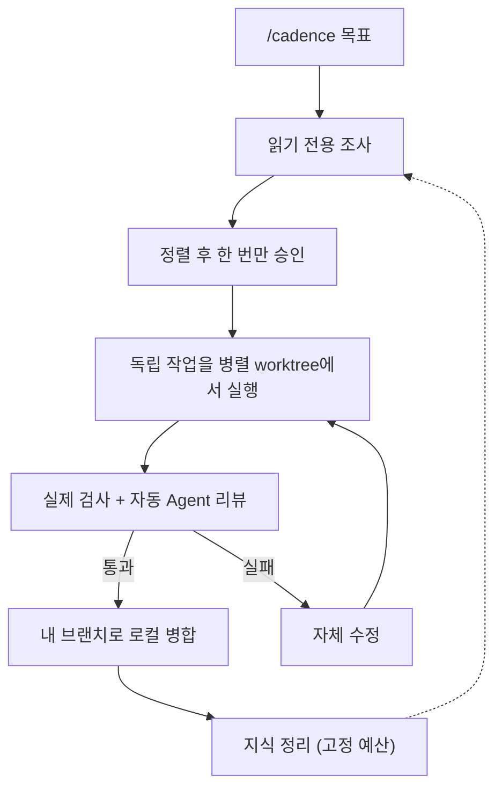
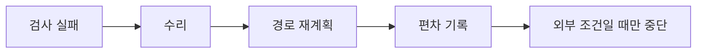
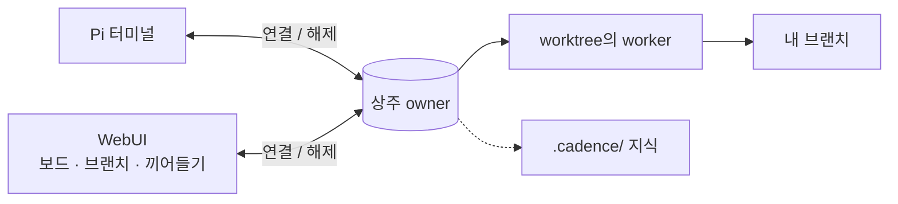

# Cadence

[English](README.md) · [简体中文](README.zh-CN.md) · [日本語](README.ja.md) · [한국어](README.ko.md) · [Deutsch](README.de.md) · [Français](README.fr.md) · [Español](README.es.md) · [Português (Brasil)](README.pt-BR.md) · [Русский](README.ru.md)

Cadence는 [Pi](https://www.npmjs.com/package/@earendil-works/pi-coding-agent)를 대화 중심의 엔지니어링 워크플로로 바꿉니다.
`/cadence [목표]`를 입력해 결과를 한 번 합의하면 상주 owner가 구현, 복구, 검증을 진행합니다.
터미널이나 선택적 WebUI에서 쓸 수 있습니다.

## 작동 방식







## Cadence를 쓰는 이유

|                                      |                                                                                       |
| ------------------------------------ | ------------------------------------------------------------------------------------- |
| **창을 닫아도 작업은 계속**          | 클라이언트는 연결과 해제만 합니다. owner는 계속 실행됩니다.                           |
| **승인 전에는 아무것도 바꾸지 않음** | 읽기 전용 조사 후 읽을 수 있는 합의 하나를 확인합니다.                                |
| **믿을 수 있는 결과**                | 실제 검사와 독립 리뷰. 모델의 문장은 통과로 인정되지 않습니다.                        |
| **스스로 완료**                      | 승인 후 수리, 재계획, 편차 기록을 알아서 하고 저장소 밖의 조건에서만 멈춥니다.        |
| **구조적으로 빠름**                  | 독립 작업은 각자의 worktree에서 나란히 실행됩니다.                                    |
| **지식이 쌓임**                      | 라우트 표와 고정 예산. worker는 해당 부분만 읽고 새 교훈이 낡은 것을 대체합니다.      |
| **보고 조종하는 WebUI**              | 작업 보드, 경로 수정, 편차, 브랜치, 사고 과정. 응답 중 끼어들기나 대기열 전송도 가능. |
| **하나의 기록**                      | 브라우저 대화는 프로젝트의 Pi 세션이며 어느 쪽에서든 이어갈 수 있습니다.              |

> Cadence는 신뢰하는 어시스턴트이며 **샌드박스가 아닙니다**.
> 에이전트는 승인된 checkout 또는 worktree에서 호스트 도구를 사용합니다.
> 검토하고 복구할 수 있는 코드에만 사용하세요.

## 설치

Node `>=22.19.0`과 모델 제공자에 로그인한 Pi가 필요합니다.
Cadence는 Pi의 로그인을 재사용합니다.

```sh
npm install -g @abelxiaoxing/cadence
pi install "$(npm root -g)/@abelxiaoxing/cadence"
cadence server install   # 선택 사항: WebUI와 부팅 서비스
```

`cadence server install`은 비공개 링크(`http://127.0.0.1:17423/?token=…`)를 출력합니다.
토큰으로 작업 공간에 접근할 수 있으니 링크를 공개하지 마세요.

## 사용법

### 브라우저

1. 출력된 링크를 한 번 엽니다(`cadence token-link --reveal`로 다시 출력).
2. 오른쪽 아래 버튼으로 작업 폴더를 고릅니다.
3. `/cadence [목표]`를 보내고 확인 질문에 답합니다.
4. **Implement this plan**을 누르고 보드와 **Subagents** 도크에서 진행을 확인합니다.
   이미지는 붙여넣기나 드롭으로 추가합니다([자세히](docs/conversation-mode.md#images-in-the-webui)).

### 터미널

신뢰하는 프로젝트의 Pi 대화에서 `/cadence <목표>`를 한 번 입력합니다.
목표가 끝나도 모드는 유지됩니다.
`exit cadence` 또는 `退出 Cadence`로 종료하며, 승인된 작업은 취소되지 않습니다.
`/cadence-history [run-id]`는 읽기 전용입니다.
`CADENCE_PARALLEL`(기본 4)이 동시 worker 수를 정합니다.
자세히: [대화 모드](docs/conversation-mode.md), [기록](docs/history.md).

```sh
cadence project open /absolute/project   # 프로젝트마다 독립된 owner, 포트, 기록
```

## 서비스 관리

```sh
cadence server status
cadence server restart     # 업그레이드나 .env / models.json 변경 후
cadence server upgrade     # 가져오기, 설치, 재시작. 새 버전이 시작되지 않으면 되돌림
cadence server stop
cadence server uninstall   # npm uninstall -g 전에
cadence doctor             # 잔여물과 최근 복구. 나머지는 --fix
```

충돌이나 정전 후에도 정리가 필요 없습니다.
다음 시작 때 자동 복구하고 무엇을 했는지 알려 줍니다.
[서비스 관리](docs/service-management.md), [원격 접속](docs/remote-access.md) 참고.

## 개발

Pi는 로컬 checkout이나 패킹된 tarball도 불러올 수 있습니다.
절대 또는 상대 경로를 Pi의 `packages`에 추가하거나 `pi -e ./cadence`를 써 보세요.
Cadence는 Pi 1.5.0 또는 호환되는 1.x 호스트가 필요합니다.
개발용 고정 버전과 테스트된 런타임은 범용 호환성 약속이 아닙니다.

```sh
bun install
bun run verify
```

영역별 안내는 [engineering/](engineering/)와 [AGENTS.md](AGENTS.md). `verify`는 유일한 빠른 게이트이며 공식 Node 빌드와 비공개 임시 디렉터리가 필요합니다([검증](engineering/verification.md)).

## 라이선스

MIT.
포함된 변형, 글꼴, 외부 구성 요소는 각자의 라이선스를 유지합니다: [재사용과 배포](docs/reuse-and-distribution.md), [서드파티 고지](THIRD_PARTY_NOTICES.md).
