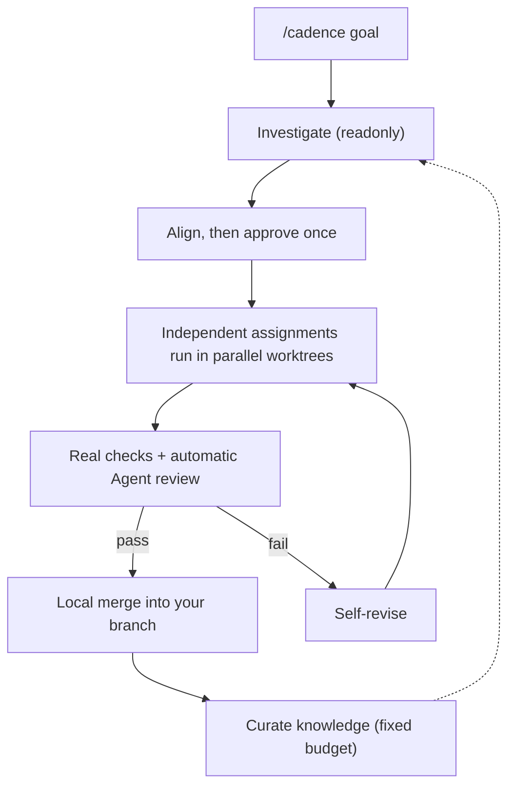
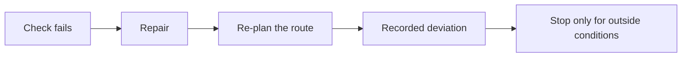
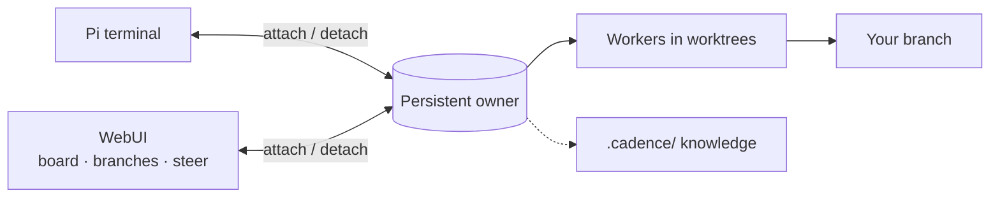

# Cadence

[English](README.md) · [简体中文](README.zh-CN.md) · [日本語](README.ja.md) · [한국어](README.ko.md) · [Deutsch](README.de.md) · [Français](README.fr.md) · [Español](README.es.md) · [Português (Brasil)](README.pt-BR.md) · [Русский](README.ru.md)

Cadence turns [Pi](https://www.npmjs.com/package/@earendil-works/pi-coding-agent) into a conversation-driven engineering workflow: enter `/cadence [goal]`, agree on the result once, and a persistent owner builds, recovers and verifies it.
Use it from the terminal or the optional WebUI.

## How it works







## Why Cadence

|                                     |                                                                                                                   |
| ----------------------------------- | ----------------------------------------------------------------------------------------------------------------- |
| **Work outlives the window**        | Clients only attach and detach; the owner keeps running.                                                          |
| **Nothing changes before approval** | Readonly investigation, then one readable agreement you confirm.                                                  |
| **Results you can trust**           | Real checks and independent review; model prose never counts as a pass.                                           |
| **Finishes on its own**             | After approval it repairs, re-plans or records a deviation, and stops only for conditions outside the repository. |
| **Faster by design**                | Independent assignments run side by side in their own worktrees.                                                  |
| **Knowledge compounds**             | A route table and a fixed budget: workers read what matches their code, new lessons replace stale ones.           |
| **WebUI that shows and steers**     | Assignment board, revisions, deviations, branches, thinking, and steer or queue a message mid-reply.              |
| **One history**                     | Browser conversations are the project's Pi sessions; continue in either place.                                    |

> Cadence is a trusted assistant, **not a sandbox**: its agents use host tools in the approved checkout or worktree.
> Use it on code you can review and recover.

## Install

Requires Node `>=22.19.0` and Pi logged in to a model provider; Cadence reuses Pi's login.

```sh
npm install -g @abelxiaoxing/cadence
pi install "$(npm root -g)/@abelxiaoxing/cadence"
cadence server install   # optional WebUI and boot service
```

`cadence server install` prints a private link (`http://127.0.0.1:17423/?token=…`).
The token grants access to your workspace: keep the link private.

## Use

### Browser

1. Open the printed link once (`cadence token-link --reveal` prints it again).
2. Pick a working folder with the lower-right button.
3. Send `/cadence [goal]`, then answer the clarifying questions.
4. Click **Implement this plan** and follow the board and the **Subagents** dock.
   Images can be pasted or dropped ([details](docs/conversation-mode.md#images-in-the-webui)).

### Terminal

Enter `/cadence <goal>` once in a trusted project's Pi conversation; the mode stays on after a goal completes.
`exit cadence` or `退出 Cadence` leaves it and never cancels accepted work.
`/cadence-history [run-id]` is readonly.
`CADENCE_PARALLEL` (default 4) sets concurrent workers.
Details: [conversation mode](docs/conversation-mode.md), [history](docs/history.md).

```sh
cadence project open /absolute/project   # one owner, port and history per project
```

## Manage the service

```sh
cadence server status
cadence server restart     # after an upgrade or a .env / models.json change
cadence server upgrade     # fetch, install, restart; rolls back if the new version fails
cadence server stop
cadence server uninstall   # before npm uninstall -g
cadence doctor             # leftovers and recent recoveries; --fix for the rest
```

A crash or power loss needs no cleanup: the next start recovers and says what it did.
See [service management](docs/service-management.md) and [remote access](docs/remote-access.md).

## Development

Pi can also load a local checkout or packed tarball: add its absolute or relative path to Pi's `packages`, or try `pi -e ./cadence`.
Cadence requires Pi 1.5.0 or a compatible 1.x host; development pins and tested runtimes are not universal compatibility promises.

```sh
bun install
bun run verify
```

Guidance by area is in [engineering/](engineering/) and [AGENTS.md](AGENTS.md). `verify` is the single fast gate; it needs an official Node build and a private temporary directory ([verification](engineering/verification.md)).

## License

MIT.
Bundled adaptations, fonts and vendors keep their own licenses: [reuse and distribution](docs/reuse-and-distribution.md), [third-party notices](THIRD_PARTY_NOTICES.md).
