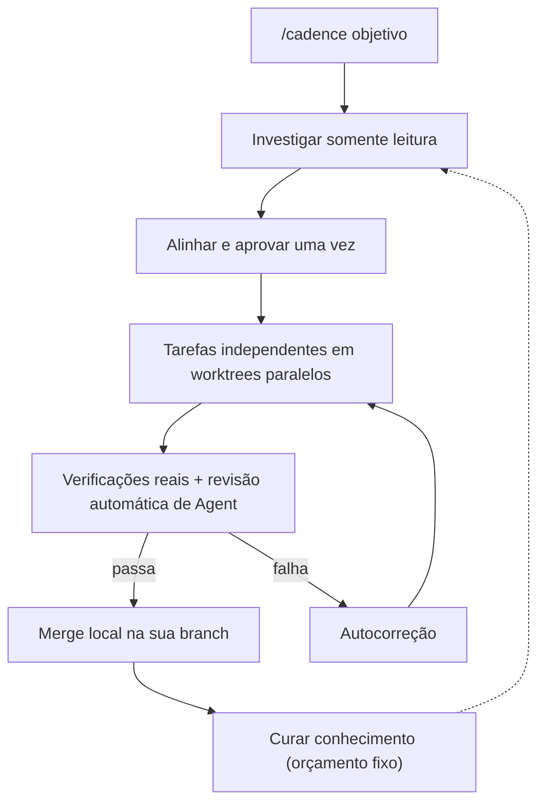
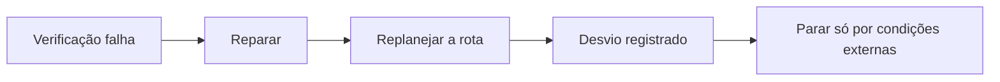
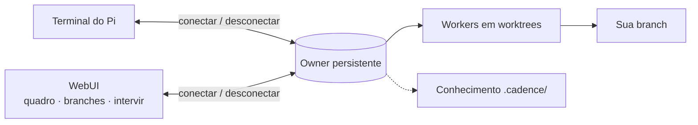

# Cadence

[English](README.md) · [简体中文](README.zh-CN.md) · [日本語](README.ja.md) · [한국어](README.ko.md) · [Deutsch](README.de.md) · [Français](README.fr.md) · [Español](README.es.md) · [Português (Brasil)](README.pt-BR.md) · [Русский](README.ru.md)

O Cadence transforma o [Pi](https://www.npmjs.com/package/@earendil-works/pi-coding-agent) em um fluxo de engenharia guiado por conversa: digite `/cadence [objetivo]`, combine o resultado uma vez e um owner persistente implementa, se recupera e verifica.
No terminal ou na WebUI opcional.

## Como funciona







## Por que o Cadence

|                                   |                                                                                                                 |
| --------------------------------- | --------------------------------------------------------------------------------------------------------------- |
| **O trabalho sobrevive à janela** | Os clientes só conectam e desconectam; o owner continua.                                                        |
| **Nada muda antes da aprovação**  | Investigação somente leitura e um acordo legível que você confirma.                                             |
| **Resultados confiáveis**         | Verificações reais e revisão independente; texto do modelo nunca conta como aprovado.                           |
| **Termina sozinho**               | Após aprovar, repara, replaneja ou registra um desvio, e só para por condições fora do repositório.             |
| **Mais rápido por desenho**       | Tarefas independentes rodam lado a lado em worktrees próprios.                                                  |
| **O conhecimento se acumula**     | Tabela de rotas e orçamento fixo: workers leem o que corresponde e lições novas substituem as obsoletas.        |
| **WebUI que mostra e conduz**     | Quadro de tarefas, revisões, desvios, branches, raciocínio; intervir ou enfileirar mensagem durante a resposta. |
| **Um só histórico**               | As conversas do navegador são as sessões do Pi do projeto; continue em qualquer lugar.                          |

> O Cadence é um assistente confiável, **não um sandbox**: seus agentes usam ferramentas do host no checkout ou worktree aprovado.
> Use em código que você possa revisar e recuperar.

## Instalação

Requer Node `>=22.19.0` e o Pi com login em um provedor de modelos; o Cadence reutiliza o login do Pi.

```sh
npm install -g @abelxiaoxing/cadence
pi install "$(npm root -g)/@abelxiaoxing/cadence"
cadence server install   # WebUI e serviço de inicialização opcionais
```

`cadence server install` mostra um link privado (`http://127.0.0.1:17423/?token=…`).
O token dá acesso ao seu workspace: mantenha o link privado.

## Uso

### Navegador

1. Abra o link exibido uma vez (`cadence token-link --reveal` mostra de novo).
2. Escolha uma pasta de trabalho no botão inferior direito.
3. Envie `/cadence [objetivo]` e responda às perguntas.
4. Clique em **Implement this plan** e acompanhe o quadro e o dock **Subagents**.
   Imagens por colar ou arrastar ([detalhes](docs/conversation-mode.md#images-in-the-webui)).

### Terminal

Digite `/cadence <objetivo>` uma vez na conversa do Pi de um projeto confiável; o modo continua ativo após concluir.
`exit cadence` ou `退出 Cadence` sai sem cancelar o trabalho aceito.
`/cadence-history [run-id]` é somente leitura.
`CADENCE_PARALLEL` (padrão 4) define os workers simultâneos.
Detalhes: [modo conversa](docs/conversation-mode.md), [histórico](docs/history.md).

```sh
cadence project open /absolute/project   # um owner, porta e histórico por projeto
```

## Gerenciar o serviço

```sh
cadence server status
cadence server restart     # após atualizar ou alterar .env / models.json
cadence server upgrade     # baixar, instalar, reiniciar; volta atrás se a nova versão falhar
cadence server stop
cadence server uninstall   # antes de npm uninstall -g
cadence doctor             # restos e recuperações recentes; --fix para o resto
```

Falha ou queda de energia não exige limpeza: a próxima inicialização se recupera e diz o que fez.
Veja [gerenciamento do serviço](docs/service-management.md) e [acesso remoto](docs/remote-access.md).

## Desenvolvimento

O Pi também carrega um checkout local ou tarball empacotado: adicione o caminho absoluto ou relativo a `packages` do Pi, ou teste `pi -e ./cadence`.
O Cadence requer o Pi 1.5.0 ou um host 1.x compatível; pins de desenvolvimento e runtimes testados não são promessas de compatibilidade universal.

```sh
bun install
bun run verify
```

Guias por área em [engineering/](engineering/) e [AGENTS.md](AGENTS.md). `verify` é o único portão rápido; exige um build oficial do Node e um diretório temporário privado ([verificação](engineering/verification.md)).

## Licença

MIT.
Adaptações, fontes e componentes de terceiros incluídos mantêm suas licenças: [reutilização e distribuição](docs/reuse-and-distribution.md), [avisos de terceiros](THIRD_PARTY_NOTICES.md).
