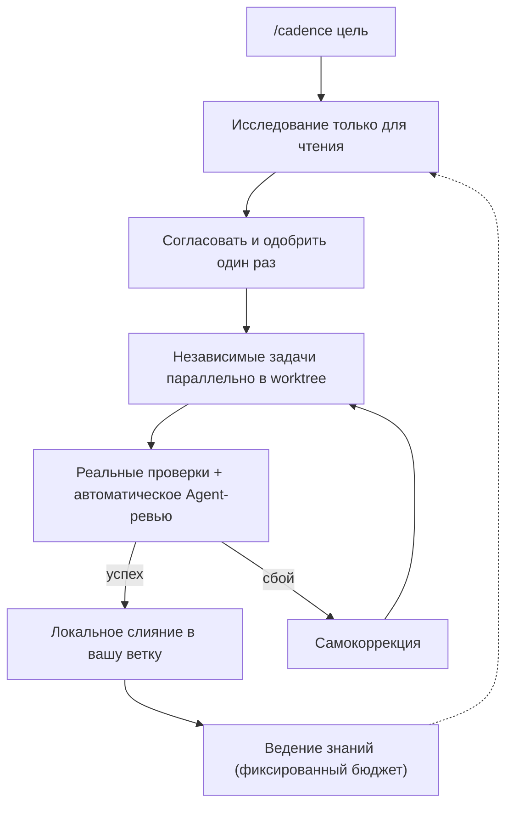
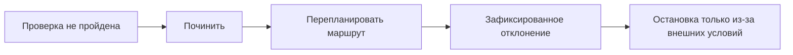
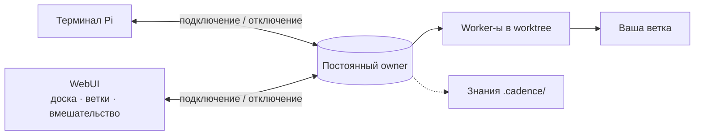

# Cadence

[English](README.md) · [简体中文](README.zh-CN.md) · [日本語](README.ja.md) · [한국어](README.ko.md) · [Deutsch](README.de.md) · [Français](README.fr.md) · [Español](README.es.md) · [Português (Brasil)](README.pt-BR.md) · [Русский](README.ru.md)

Cadence превращает [Pi](https://www.npmjs.com/package/@earendil-works/pi-coding-agent) в инженерный процесс, управляемый диалогом: введите `/cadence [цель]`, один раз согласуйте результат, и постоянный owner реализует, восстанавливается и проверяет.
В терминале или в необязательном WebUI.

## Как это работает







## Почему Cadence

|                                            |                                                                                                                                |
| ------------------------------------------ | ------------------------------------------------------------------------------------------------------------------------------ |
| **Работа переживает окно**                 | Клиенты только подключаются и отключаются; owner продолжает работать.                                                          |
| **До одобрения ничего не меняется**        | Сначала исследование только для чтения, затем понятное соглашение, которое вы подтверждаете.                                   |
| **Надёжный результат**                     | Реальные проверки и независимое ревью; текст модели никогда не считается успехом.                                              |
| **Доводит до конца сам**                   | После одобрения чинит, перепланирует или фиксирует отклонение и останавливается лишь из-за условий вне репозитория.            |
| **Быстрее по устройству**                  | Независимые задачи идут параллельно в своих worktree.                                                                          |
| **Знания накапливаются**                   | Таблица маршрутов и фиксированный бюджет: worker-ы читают нужное, новые уроки вытесняют устаревшие.                            |
| **WebUI, который показывает и направляет** | Доска задач, ревизии, отклонения, ветки, рассуждения; можно вмешаться или поставить сообщение в очередь прямо во время ответа. |
| **Одна история**                           | Диалоги в браузере — это сессии Pi проекта; продолжайте где удобно.                                                            |

> Cadence — доверенный помощник, **не песочница**: его агенты используют инструменты хоста в одобренном checkout или worktree.
> Применяйте на коде, который вы можете проверить и восстановить.

## Установка

Нужны Node `>=22.19.0` и Pi с входом у провайдера моделей; Cadence использует вход Pi.

```sh
npm install -g @abelxiaoxing/cadence
pi install "$(npm root -g)/@abelxiaoxing/cadence"
cadence server install   # необязательные WebUI и служба автозапуска
```

`cadence server install` выводит приватную ссылку (`http://127.0.0.1:17423/?token=…`).
Токен даёт доступ к вашему рабочему пространству: не публикуйте ссылку.

## Использование

### Браузер

1. Один раз откройте выведенную ссылку (`cadence token-link --reveal` покажет её снова).
2. Выберите рабочую папку кнопкой справа внизу.
3. Отправьте `/cadence [цель]` и ответьте на уточняющие вопросы.
4. Нажмите **Implement this plan** и следите за доской и панелью **Subagents**.
   Изображения — вставкой или перетаскиванием ([подробнее](docs/conversation-mode.md#images-in-the-webui)).

### Терминал

Введите `/cadence <цель>` один раз в диалоге Pi доверенного проекта; режим остаётся после завершения цели.
`exit cadence` или `退出 Cadence` выходит из режима, не отменяя принятую работу.
`/cadence-history [run-id]` — только чтение.
`CADENCE_PARALLEL` (по умолчанию 4) задаёт число одновременных worker-ов.
Подробнее: [режим диалога](docs/conversation-mode.md), [история](docs/history.md).

```sh
cadence project open /absolute/project   # свой owner, порт и история у каждого проекта
```

## Управление службой

```sh
cadence server status
cadence server restart     # после обновления или изменения .env / models.json
cadence server upgrade     # загрузить, установить, перезапустить; откат, если новая версия не запустилась
cadence server stop
cadence server uninstall   # перед npm uninstall -g
cadence doctor             # остатки и недавние восстановления; --fix для остального
```

После сбоя или отключения питания чистка не нужна: следующий запуск восстановится и сообщит, что сделал.
См.
[управление службой](docs/service-management.md) и [удалённый доступ](docs/remote-access.md).

## Разработка

Pi может загрузить и локальный checkout, или упакованный tarball: добавьте его абсолютный или относительный путь в `packages` Pi либо попробуйте `pi -e ./cadence`.
Cadence требует Pi 1.5.0 или совместимый хост 1.x; закреплённые версии и проверенные среды не являются универсальными обещаниями совместимости.

```sh
bun install
bun run verify
```

Руководства по областям: [engineering/](engineering/) и [AGENTS.md](AGENTS.md). `verify` — единственный быстрый барьер; нужны официальная сборка Node и приватный временный каталог ([проверка](engineering/verification.md)).

## Лицензия

MIT.
Включённые адаптации, шрифты и сторонние компоненты сохраняют свои лицензии: [повторное использование и распространение](docs/reuse-and-distribution.md), [уведомления третьих сторон](THIRD_PARTY_NOTICES.md).
