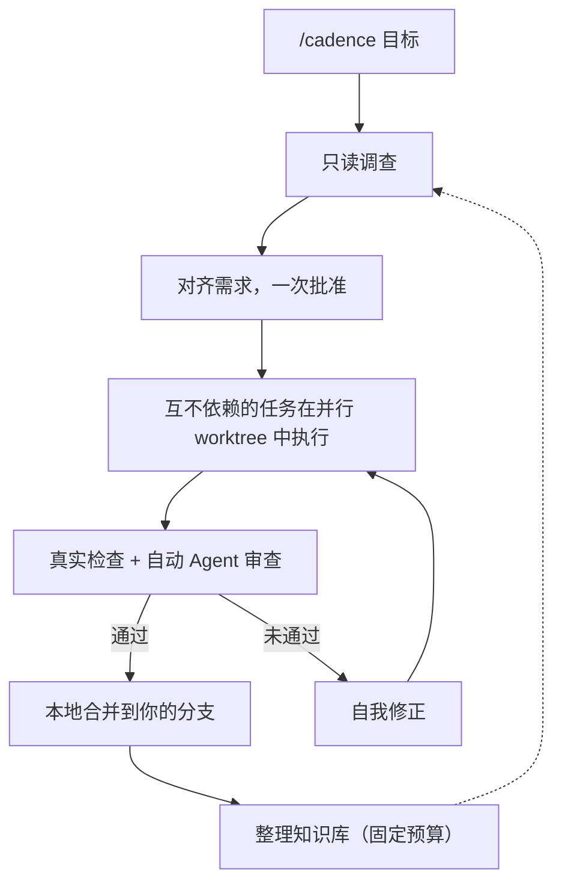
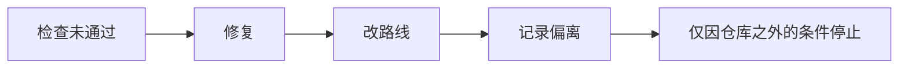
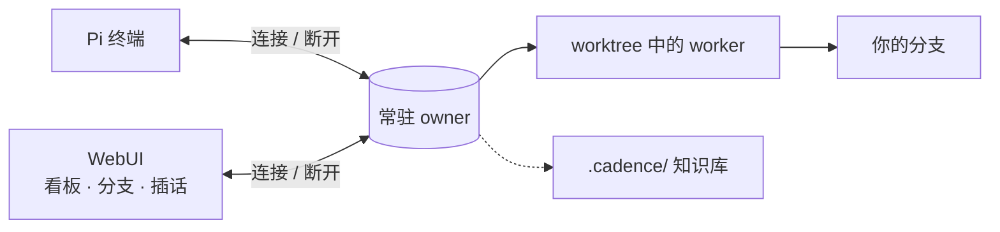

# Cadence

[English](README.md) · [简体中文](README.zh-CN.md) · [日本語](README.ja.md) · [한국어](README.ko.md) · [Deutsch](README.de.md) · [Français](README.fr.md) · [Español](README.es.md) · [Português (Brasil)](README.pt-BR.md) · [Русский](README.ru.md)

Cadence 把 [Pi](https://www.npmjs.com/package/@earendil-works/pi-coding-agent) 变成对话驱动的工程工作流：输入 `/cadence [目标]`，一次对齐预期结果，之后由常驻 owner 实现、恢复并验证。
可在终端使用，也可使用可选的 WebUI。

## 工作方式







## 为什么选择 Cadence

|                            |                                                                        |
| -------------------------- | ---------------------------------------------------------------------- |
| **工作不随窗口结束**       | 客户端只是连接和断开，owner 持续运行。                                 |
| **批准之前不改任何文件**   | 先只读调查，再给出一份可读的约定，由你确认。                           |
| **结果可信**               | 真实检查加独立审查；模型的文字不算通过。                               |
| **自己做完**               | 批准后自行修复、改路线或记录偏离，只因仓库之外的条件停下。             |
| **天生更快**               | 互不依赖的任务在各自的 worktree 中并行。                               |
| **知识持续积累**           | 路由表加固定预算：worker 只读与代码对应的部分，新经验替换过时内容。    |
| **看得见也能插话的 WebUI** | 任务看板、路线修订、偏离、分支、思考块；回复进行中可插队或排队发消息。 |
| **一份历史**               | 浏览器对话就是项目的 Pi 会话，两边都能继续。                           |

> Cadence 是受信任的助手，**不是沙箱**：它的代理在获批的 checkout 或 worktree 中使用宿主工具。
> 请只在你能审阅和恢复的代码上使用。

## 安装

需要 Node `>=22.19.0`，以及已登录模型提供商的 Pi；Cadence 复用 Pi 的登录。

```sh
npm install -g @abelxiaoxing/cadence
pi install "$(npm root -g)/@abelxiaoxing/cadence"
cadence server install   # 可选的 WebUI 与开机服务
```

`cadence server install` 会打印私有链接（`http://127.0.0.1:17423/?token=…`）。
令牌可访问你的工作区，请妥善保管链接。

## 使用

### 浏览器

1. 打开打印出的链接一次（`cadence token-link --reveal` 可再次打印）。
2. 用右下角按钮选择工作文件夹。
3. 发送 `/cadence [目标]`，回答澄清问题。
4. 点击 **Implement this plan**，在看板和 **Subagents** 面板中跟进。
   图片可粘贴或拖入（[详情](docs/conversation-mode.md#images-in-the-webui)）。

### 终端

在受信任项目的 Pi 对话里输入一次 `/cadence <目标>`；目标完成后模式仍保持开启。
`exit cadence` 或 `退出 Cadence` 退出模式，不会取消已接受的工作。
`/cadence-history [run-id]` 为只读。
`CADENCE_PARALLEL`（默认 4）设置并发 worker 数。
详情：[对话模式](docs/conversation-mode.md)、[历史](docs/history.md)。

```sh
cadence project open /absolute/project   # 每个项目独立的 owner、端口与历史
```

## 管理服务

```sh
cadence server status
cadence server restart     # 升级或修改 .env / models.json 之后
cadence server upgrade     # 下载、安装、重启；新版本无法启动则回退
cadence server stop
cadence server uninstall   # 在 npm uninstall -g 之前
cadence doctor             # 残留与最近的恢复；--fix 处理其余
```

崩溃或断电无需清理：下次启动会自动恢复并说明做了什么。
见[服务管理](docs/service-management.md)与[远程访问](docs/remote-access.md)。

## 开发

Pi 也可加载本地检出或打包的 tarball：把它的绝对或相对路径加入 Pi 的 `packages`，或试用 `pi -e ./cadence`。
Cadence 需要 Pi 1.5.0 或兼容的 1.x 宿主；开发固定版本和测试过的运行时不是通用兼容性承诺。

```sh
bun install
bun run verify
```

按领域划分的说明见 [engineering/](engineering/) 与 [AGENTS.md](AGENTS.md)。
`verify` 是唯一的快速门禁，需要官方 Node 构建和私有临时目录（[验证](engineering/verification.md)）。

## 许可证

MIT。
随附的改编、字体和第三方组件保留各自的许可证：[复用与分发](docs/reuse-and-distribution.md)、[第三方声明](THIRD_PARTY_NOTICES.md)。
